# Class diagram

The diagram below reflects the current domain model, application contracts, infrastructure implementation, and API flow. `ExpenseService` exposes update and delete operations through its interface, but those operations are not implemented yet.

```mermaid
classDiagram-v2
    direction TB

    namespace Domain {
        class Expense {
            <<Entity>>
            + Id: Guid
            + Date: DateOnly
            + Amount: decimal
            + Merchant: string
            + Category: Category
            + SubCategory: string?
            + PaymentMethod: PaymentMethod
            + ExpenseType: ExpenseType
            + Expense(Guid, DateOnly, decimal, string, Category, string?, PaymentMethod, ExpenseType)
        }

        class Income {
            <<Entity>>
            + Id: Guid
            + IncomeType: IncomeType
            + Amount: decimal
            + Date: DateOnly
            + Income(Guid, IncomeType, decimal, DateOnly)
        }

        class Budget {
            <<Entity>>
            + Id: Guid
            + TotalPlannedAmount: decimal
            + StartDate: DateOnly
            + EndDate: DateOnly
            + Budget(Guid, decimal, DateOnly, DateOnly)
            + CalculateSummary(IEnumerable~Expense~, IEnumerable~Income~): BudgetSummary
            - IsInRange(DateOnly) bool
        }

        class BudgetSummary {
            + ExpenseTotalsByCategory: IReadOnlyDictionary~Category, decimal~
            + IncomeTotalsByType: IReadOnlyDictionary~IncomeType, decimal~
            + TotalInPeriodExpenses: decimal
            + RemainingBudget: decimal
            + BudgetSummary(...)
        }

        class Category {
            <<Enumeration>>
            Housing = 1
            Food = 2
            Transportation = 3
            Utilities = 4
            Healthcare = 5
            Insurance = 6
            DebtRepayment = 7
            PersonalCare = 8
            Entertainment = 9
            Education = 10
            Travel = 11
            Shopping = 12
            GiftsAndDonations = 13
            SavingsAndInvestments = 14
            Taxes = 15
            Other = 16
        }

        class PaymentMethod {
            <<Enumeration>>
            Cash = 1
            DebitCard = 2
            CreditCard = 3
            BankTransfer = 4
            DirectDebit = 5
            MobilePayment = 6
            DigitalWallet = 7
            BuyNowPayLater = 8
            Crypto = 9
            Voucher = 19
        }

        class ExpenseType {
            <<Enumeration>>
            Personal = 1
            Fixed = 2
            Variable = 3
            OneTime = 4
            Subscription = 5
        }

        class IncomeType {
            <<Enumeration>>
            Salary = 1
            Freelance = 2
            Business = 3
            Investment = 4
            Rental = 5
            GovernmentBenefit = 6
            Gift = 7
            Other = 8
        }
    }

    namespace Application {
        class CreateExpenseRequest {
            <<Request>>
            + Date: DateOnly
            + Amount: decimal
            + Merchant: string
            + Category: Category
            + SubCategory: string?
            + PaymentMethod: PaymentMethod
            + ExpenseType: ExpenseType
        }

        class UpdateExpenseRequest {
            <<Request>>
            + Date: DateTime?
            + Amount: decimal?
            + Merchant: string?
            + Category: Category?
            + SubCategory: string?
            + PaymentMethod: PaymentMethod?
            + ExpenseType: ExpenseType?
        }

        class ExpenseResponse {
            <<Response>>
            + Id: Guid
            + Date: DateOnly
            + Amount: decimal
            + Merchant: string
            + Category: Category
            + SubCategory: string?
            + PaymentMethod: PaymentMethod
            + ExpenseType: ExpenseType
        }

        class IExpensesService {
            <<Interface>>
            + GetAllAsync(CancellationToken) Task~IReadOnlyList~ExpenseResponse~~
            + GetByIdAsync(string, CancellationToken) Task~ExpenseResponse?~
            + CreateAsync(CreateExpenseRequest, CancellationToken) Task~ExpenseResponse~
            + UpdateAsync(string, UpdateExpenseRequest, CancellationToken) Task~bool~
            + DeleteAsync(string, CancellationToken) Task~bool~
        }

        class ExpenseService {
            + CreateAsync(CreateExpenseRequest, CancellationToken) Task~ExpenseResponse~
            + GetAllAsync(CancellationToken) Task~IReadOnlyList~ExpenseResponse~~
            + GetByIdAsync(string, CancellationToken) Task~ExpenseResponse?~
            + UpdateAsync(string, UpdateExpenseRequest, CancellationToken) Task~bool~
            + DeleteAsync(string, CancellationToken) Task~bool~
            - MapToExpenseResponse(Expense) ExpenseResponse
        }

        class IExpensesRepository {
            <<Interface>>
            + Add(Expense, CancellationToken) Task
            + GetAllAsync(CancellationToken) Task~IReadOnlyList~Expense~
        }

    }

    namespace Infrastructure {
        class ExpensesRepository {
            - _expenses: List~Expense~
            + Add(Expense, CancellationToken) Task
            + GetAllAsync(CancellationToken) Task~IReadOnlyList~Expense~
        }
    }

    namespace API {
        class ExpensesController {
            <<Controller>>
            + Create(CreateExpenseRequest, CancellationToken) ActionResult~ExpenseResponse~
            + GetAll(CancellationToken) ActionResult~IEnumerable~ExpenseResponse~~
            + GetById(string, CancellationToken) ActionResult~ExpenseResponse~
        }
    }

    Expense --> Category : uses
    Expense --> PaymentMethod : uses
    Expense --> ExpenseType : uses
    Income --> IncomeType : uses
    Budget --> BudgetSummary : creates
    Budget ..> Expense : summarizes
    Budget ..> Income : summarizes
    BudgetSummary ..> Category : groups by
    BudgetSummary ..> IncomeType : groups by

    ExpenseService ..|> IExpensesService
    ExpenseService --> IExpensesRepository : uses
    ExpenseService ..> Expense : creates and maps
    ExpenseService ..> CreateExpenseRequest : accepts
    ExpenseService ..> ExpenseResponse : returns
    IExpensesRepository ..> Expense : stores
    ExpensesRepository ..|> IExpensesRepository
    ExpensesRepository o-- Expense : stores in memory
    ExpensesController --> IExpensesService : uses
    ExpensesController ..> CreateExpenseRequest : accepts
    ExpensesController ..> ExpenseResponse : returns
```

